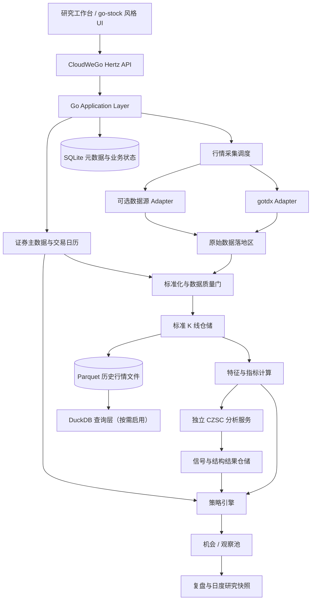

# CloudWeGo + Go：A股辅助平台 V1 数据中心详细设计

- 版本：V1.0（架构设计稿）
- 日期：2026-10-30
- 适用范围：个人 A 股选股、择时、买卖辅助、观察跟踪与复盘
- 明确不包含：回测、券商连接、自动下单、订单执行、实盘自动化
- 技术基线：Go + CloudWeGo Hertz；gotdx 行情适配；CZSC 独立分析服务

---

## 1. 设计目标与边界

数据中心是整个系统的事实基础。它不负责判断股票是否值得买，而是对外提供经过标准化、质量检查、可追溯的数据。

V1 数据中心必须回答：

1. 某只证券在某个历史日期是否属于目标 A 股股票池？
2. 某个交易日、某个周期的 K 线来自哪里、什么时候采集、是否完整？
3. 当前分析采用的是原始价、前复权还是后复权？复权因子在分析时点是否已知？
4. 数据缺失、停牌、接口失败和数据源返回空列表之间有什么区别？
5. 相同输入和相同配置能否重新得到相同的技术分析结果？

V1 重点提供三类数据能力：

- 证券主数据：全市场证券范围、证券属性、上市状态、行业和交易日历。
- 行情数据：实时快照、日线、30 分钟、60 分钟 K 线及必要的成交量价字段。
- 数据治理：标准化、校验、复权、版本、缺失检测、来源追溯和扫描快照。

本阶段不建设回测引擎，但保留历史行情和信号时间戳。历史数据的用途是当前 CZSC 结构计算、趋势计算、信号追踪和复盘，不是历史收益模拟。

## 2. CloudWeGo 技术选型

### 2.1 V1 推荐组合

| CloudWeGo 组件 | V1 决策 | 责任 |
|---|---|---|
| Hertz | 采用 | 对 UI / 本地工作台提供 HTTP API；统一请求校验、错误返回、中间件、请求 ID、日志和可观测性入口 |
| Kitex | 暂不采用 | 当前没有必要拆分 Go 微服务；模块之间直接调用 Go 接口。未来存在独立 Go 服务时再评估 |
| Eino | 暂不进入数据核心 | 后续用于 AI 助手的工作流、检索与工具编排；不参与行情校验、指标计算、策略状态机等确定性逻辑 |
| Sonic | 暂不强制采用 | 先使用标准 JSON 编码；只有基准测试证明序列化是瓶颈时再替换 |
| Netpoll | 不直接依赖 | 由选用的 CloudWeGo 框架内部管理，不在业务层操作网络库 |
| hz | 可选 | 可用于 API / IDL 脚手架生成；生成代码与业务规则分离，避免生成器决定领域模型 |

CloudWeGo 是可以按需组合使用的组件集合，不意味着项目必须采用微服务。V1 推荐“模块化单体 + Hertz API 服务 + 独立 CZSC 分析进程”，避免为框架而拆服务。

### 2.2 Hertz 的具体位置

Hertz 只负责 API 入口，不承担行情采集、K 线计算或策略判断。

调用链：

`Hertz Handler -> Application Service -> Domain Service -> Repository / Provider Adapter`

Hertz 负责：

- HTTP 路由及版本前缀，例如 `/api/v1`。
- 请求参数绑定与校验。
- 统一错误码、响应结构和请求追踪 ID。
- CORS、访问日志、恢复、超时和基本鉴权（本机部署也保留鉴权边界）。
- 提供扫描任务状态、股票池查询、K 线查询、信号查询、观察池和复盘数据 API。

Hertz Handler 不允许直接访问 gotdx Client、SQL 表或 CZSC 算法。所有业务操作必须经过应用层接口。

### 2.3 为什么 V1 不用 Kitex

当前 Go 业务模块同进程运行，模块间 RPC 没有收益，增加 Kitex 只会增加 IDL、服务启动、部署和排错成本。

CZSC 当前是独立的 Python / Rust 分析能力，不是 Go 服务。第一版建议使用版本化 HTTP/JSON 批量接口，便于独立调试与 Python 侧集成。未来如分析服务采用标准 gRPC，或 Go 侧出现多个独立服务，再比较 Kitex 与标准 gRPC 客户端的互操作性，不预先假设二者可以无缝互换。

## 3. 逻辑架构



部署形态：单机优先。Go 主程序运行 Hertz API、定时任务和有界 worker pool；CZSC 作为独立进程运行。数据源适配器、策略引擎和市场分析模块通过 Go interface 在进程内调用。

## 4. 证券主数据（Instrument Master）

### 4.1 主键与代码规范

证券唯一标识不应只使用六位代码。推荐规范化标识：`exchange + symbol`，对外展示可使用 `600519.SH`、`000001.SZ`、`430047.BJ`。

核心字段：

| 字段 | 说明 |
|---|---|
| instrument_id | 系统内部稳定 ID，不因简称变化而变化 |
| symbol | 证券代码，不含交易所后缀 |
| exchange | SSE / SZSE / BSE |
| ts_code | 规范展示代码，如 `600519.SH` |
| name | 当前证券简称 |
| security_type | 普通股票、ETF、LOF、指数、债券等 |
| board | 主板、创业板、科创板、北交所等 |
| list_date / delist_date | 上市、退市日期 |
| listing_status | 上市、暂停上市、退市等当前状态 |
| currency | 交易币种 |
| lot_size | 最小交易单位（用于信息展示，不做订单执行） |
| source / source_updated_at | 来源和来源更新时间 |
| valid_from / valid_to | 属性的有效区间 |

不要单靠证券代码前缀推断证券类型、板块或是否为普通 A 股。应以证券主数据和有效期字段判断。

### 4.2 历史状态必须保留

至少分别维护：

- `instrument`：证券稳定身份和当前基础属性。
- `instrument_status_history`：ST / *ST、停牌、复牌、退市整理、上市状态等带有效期的状态变化。
- `industry_membership_history`：证券所属行业及变更有效期。
- `corporate_action`：分红、送转、配股、拆并股等公司行动及其公告时间、除权生效时间。
- `trade_calendar`：交易所交易日历，不能用自然日替代交易日。

历史证券不得因退市而从主数据和历史行情中物理删除。扫描某日股票池时，按该日有效状态计算。

### 4.3 股票池定义

V1 默认目标：沪深北交易所 A 股普通股票。

ETF、LOF、指数、债券、可转债、B 股、港股、美股不进入默认普通股票扫描池，但可以保留证券类型和查询能力，未来扩展时不需要修改主键模型。

ST / *ST 不从历史数据层删除。默认策略扫描时可以标记为不可进入普通候选，用户可以在扫描配置中显式调整。

### 4.4 gotdx 的职责边界

`gotdx` 是行情和证券列表的接入适配器，不是系统证券主数据的唯一权威。

它可以贡献：

- 沪深北证券列表和代码名称基础信息。
- 实时快照、K 线、分时、逐笔等通达信协议数据。

系统仍需用其他可信来源补充或核验上市/退市状态、ST 历史、行业历史、公司行动和交易日历。每个字段记录来源、采集时间和生效时间。

同步股票列表时使用 upsert，但不能将一次空响应解释为全市场股票已清空。必须有市场级同步状态、数量对比、差异比例阈值和异常保护。

## 5. 行情接入与数据源管理

### 5.1 Provider 接口类别

按业务能力定义接口，不让策略层依赖具体供应商：

- `InstrumentProvider`：证券列表和证券基础信息。
- `QuoteProvider`：实时快照。
- `BarProvider`：历史 K 线和分钟线。
- `CalendarProvider`：交易日历。
- `FundamentalProvider`：财务指标和公告数据（后续逐步接入）。
- `CorporateActionProvider`：分红、送转及复权因子。

`TdxProvider` 实现主要证券列表、快照和 K 线能力。其他数据源以独立 adapter 增加，不把供应商 HTTP 参数散落到业务模块。

### 5.2 数据源优先级与降级

每种数据类型可以有不同的主来源和备用来源，不应设置一个全局供应商优先级。

例如：

| 数据 | 主来源 | 备用 / 核验来源 |
|---|---|---|
| 沪深北证券列表 | gotdx | 其他证券基础资料源 |
| 实时快照 | gotdx | 腾讯 / 新浪 / 东方财富等可用源 |
| 日线与分钟线 | gotdx | 东方财富或其他合规可用历史行情源 |
| 财务及公告 | Tushare 或其他结构化资料源 | 另一数据源交叉核验 |
| 交易日历 | 交易所日历 | 数据供应商日历核验 |
| 公司行动与复权 | 公告 / 结构化公司行动源 | 第二来源核验 |

这张表是架构建议，不代表所有备用源已经实现或拥有相同覆盖率。上线前逐个验证接口可用性、字段单位、历史范围、调用限制和使用条款。

### 5.3 采集状态

对每个 `source + market + dataset + trade_date` 维护采集状态：

- `SUCCESS`：完整成功。
- `PARTIAL`：部分证券或部分分页成功。
- `FAILED`：明确失败。
- `STALE`：成功获取但数据更新时间落后于预期。
- `SUCCESS_EMPTY`：接口明确成功且返回空数据，需结合业务语义判定是否合理。
- `UNKNOWN`：尚未采集或无法确认。

失败、部分成功和成功空结果必须区分。不能用空切片同时代表“无数据”“停牌”“接口失败”。

### 5.4 请求控制

- 每个 Provider 有独立并发上限、超时、重试和退避。
- 对 gotdx Client 的并发安全先以实际实现与 race 测试验证；未确认前同一 Client 串行调用，不假定 Client 可被任意 goroutine 并发共享。
- 股票之间可以并行，单只股票的数据时序更新必须串行。
- 重试只针对临时错误；业务错误、无权限和参数错误不无限重试。
- 采集任务记录请求批次、成功数、失败代码、耗时、重试次数和数据源响应时间。

## 6. 统一 K 线数据模型

### 6.1 规范字段

推荐标准 K 线模型：

| 字段 | 说明 |
|---|---|
| instrument_id / symbol | 证券标识 |
| frequency | `1d`、`60m`、`30m` |
| bar_start_at / bar_end_at | K 线开始和结束时间，内部统一时间语义 |
| session_date | 上海证券交易所本地交易日 |
| open / high / low / close | 原始未复权价格 |
| prev_close | 原始口径昨收价（如来源提供） |
| volume | 统一为股，需验证供应商返回单位后转换 |
| amount | 统一为人民币元 |
| turnover_rate | 换手率，明确百分数还是小数 |
| is_complete | 是否已完成 K 线 |
| source_id | 来源标识 |
| source_updated_at | 来源提供的数据更新时间（如可获得） |
| collected_at | 本系统采集时间 |
| data_version | 规范化记录版本 |
| quality_status | 数据质量状态 |

规范主键：`instrument_id + frequency + bar_end_at + price_basis`。原始源响应可另存原始文件或原始 payload 摘要，便于问题追查。

### 6.2 时间和交易时段

- 交易所本地时区固定为 `Asia/Shanghai`。
- 数据库存储时间戳建议统一 UTC，同时保留 `session_date` 和明确的交易所本地时间语义。
- 不能仅用 `time.Local` 解释行情时间。
- 日线、30 分钟、60 分钟 K 线必须定义 bar 的结束时间语义，统一休市间隔、午休和最后一根 K 线的边界。
- 竞价数据与连续竞价 K 线分开存储，不把集合竞价时段误合并进普通分钟线。
- 不能随意把 30 分钟聚合成 60 分钟；若未来需要聚合，必须按交易时段和交易所边界定义，并对照原生 60 分钟数据验证。

### 6.3 完成 K 线规则

- 盘中尚未结束的 K 线可以用于 UI 实时展示，但标记 `is_complete=false`。
- CZSC 正式信号分析只消费已完成 K 线。
- 同一根未完成 K 线不断变化时，不能把它当成多根新 K 线反复写入结构状态。
- 收盘确认后只提交该根 K 线的最终版本。
- 对历史 K 线发生修订时，记录修订版本，并从修订点重放受影响的分析状态。

### 6.4 单位和价格精度

在数据适配器边界完成单位转换：

- 价格统一使用 Decimal 或明确精度的定点数语义，禁止在核心领域依赖二进制浮点数进行价格相等判断。
- 成交量统一为股；成交额统一为人民币元。
- 供应商返回手、股、千元、元或百分比等单位时，必须通过 Provider 映射显式转换并测试。
- 价格精度、最小报价单位和板块差异作为证券属性或交易规则资料保存，不凭默认值硬编码。

## 7. 复权与公司行动

### 7.1 原始价是事实底座

数据库保留未复权原始 OHLCV，不用前复权价格覆盖原始价格。复权价是按公司行动因子计算出来的分析视图。

### 7.2 分离保存公司行动和复权因子

公司行动至少记录：

- 公告时间 `announced_at`。
- 股权登记日、除权除息日、生效日期。
- 现金分红、送股、转增、配股等事件类型和参数。
- 来源、采集时间、修订版本。
- 复权因子及其生效日期、版本。

### 7.3 历史分析的 PIT 规则

即使 V1 不做回测，也必须防止历史复盘时使用当时尚未发生或尚未公告的公司行动。

每次分析使用明确的 `as_of`，生成对应时点可知的复权因子快照。严禁在历史时点的复盘中直接读取今天重新计算的整段前复权序列而不做版本隔离。

CZSC 使用的价格基准必须配置化并写入分析记录，例如 `raw` 或 `as_of_qfq`。同一分析任务的多个周期必须使用同一价格基准及因子版本。

## 8. 数据质量门

数据质量检查至少分四层。

### 8.1 证券层

- 证券是否在 `session_date` 有效上市。
- 是否属于目标普通 A 股类型。
- 当日停牌、退市或风险警示状态是否正确。
- 股票池同步是否覆盖沪、深、北三个市场。

### 8.2 K 线层

- OHLC 非空且价格为正（特殊情况必须显式处理）。
- `high >= max(open, close, low)`。
- `low <= min(open, close, high)`。
- 成交量和成交额非负。
- 同证券、同周期、同结束时间无意外重复。
- 时间顺序正确，交易时段边界正确。
- 与停牌状态一致；停牌日无 K 线不等于采集失败。

### 8.3 连续性层

- 根据交易日历判断预期 K 线数量。
- 区分午休、节假日、停牌、未上市、数据缺失。
- 对 30m / 60m 线分别校验交易时段数量和结束时间。
- 对异常跳价、成交量、成交额使用阈值告警，不轻易自动删除原始数据。

### 8.4 来源层

- 检查主源与备用源价格差异。
- 不把来自不同供应商的 OHLC 四个字段拼成一根 K 线。
- 备用源替代时记录 `source_id` 和替代原因。
- 同一时间多源存在冲突时，保留各源原值，按数据政策确定规范值。

数据质量结果应返回明确状态和原因；不合格数据不进入正式策略分析。

## 9. 存储方案

V1 单人本地使用，建议先采用轻量组合：

| 存储 | 主要保存内容 | 理由 |
|---|---|---|
| SQLite | 证券主数据、状态历史、交易日历、配置、扫描任务、信号、观察池、手工交易记录 | 事务型业务状态、易部署和备份 |
| Parquet | 标准化历史 K 线、较大批量的特征快照 | 列式压缩、适合批量扫描和历史分析 |
| DuckDB | 对 Parquet 做本地分析查询 | 适合批量筛选、统计和研究查询；不作为业务状态主库 |
| 内存缓存 | 最近行情、扫描上下文和热点证券 | 降低重复读取，不作为持久事实来源 |

初版不必同时部署 PostgreSQL、Redis、Kafka、ClickHouse。只有出现多用户、多机、多进程高并发或数据量瓶颈，再依据指标升级。

### 9.1 Parquet 分区建议

建议按 `market / frequency / year / month` 或 `frequency / year / month` 分区，文件内按 `instrument_id, bar_end_at` 排序。避免一个股票一个小文件造成海量小文件问题。

历史数据写入时采用批量追加和分区重写策略；不要以每根 K 线单独创建一个文件。

### 9.2 SQLite 数据表建议

- `instrument`
- `instrument_status_history`
- `industry_membership_history`
- `trade_calendar`
- `corporate_action`
- `adjustment_factor_snapshot`
- `data_source_registry`
- `ingestion_run`
- `ingestion_item_status`
- `bar_manifest`
- `scan_run`
- `strategy_signal`
- `strategy_decision`
- `watchlist_item`
- `journal_entry`
- `daily_review_snapshot`
- `config_version`

K 线主体主要放 Parquet，SQLite 维护分区清单、版本和覆盖范围。

## 10. 扫描管线与 CZSC 输入

### 10.1 每日管线

```text
交易日历确认
  -> 同步证券主数据和状态
  -> 更新行业/公司行动等慢变数据
  -> 更新日线及 30m/60m K 线
  -> 标准化和质量检查
  -> 计算公共特征
  -> 日线环境与候选初筛
  -> CZSC 结构分析
  -> 三买策略与趋势突破策略分别评估
  -> 统一机会列表
  -> 观察池状态更新
  -> 生成当日研究快照
```

### 10.2 计算顺序

- 第一轮：全市场做证券状态、停牌、基础流动性和数据质量过滤。
- 第二轮：全市场日线做低成本趋势、成交额和量价特征计算。
- 第三轮：候选集做 CZSC 日线 / 60 分钟结构分析；30 分钟用于择时确认。
- 两套策略各自读取公共数据和分析结果，独立产生信号与决策。

不要依赖第三方智能选股结果作为唯一股票池，也不把第三方第一页结果视为全量。

### 10.3 CZSC 服务接口

V1 用 HTTP/JSON 版本化接口批量调用独立 CZSC 服务。请求至少包含：

- `request_id`、`analysis_id`。
- `instrument_id`、`symbol`。
- `as_of`、`data_version`、`price_basis`、`adjustment_version`。
- 所需周期和 CZSC 信号配置版本。
- 已完成的标准 K 线序列或服务端可引用的数据快照 ID。

返回至少包含：

- 分析状态、数据覆盖范围、最后一根已完成 K 线时间。
- CZSC 版本、信号配置版本。
- 分型、笔、中枢摘要及其时间和价格区间（按需）。
- 每个信号的名称、值、参数、触发时间和来源周期。
- 缺数、笔数不足、行情未完成等不可分析原因。

CZSC 服务不返回账户持仓或真实交易建议；Go 策略层根据结构和市场环境形成买卖辅助决策。

### 10.4 状态更新一致性

- 同一证券的 CZSC 增量状态必须按 K 线结束时间串行更新。
- 不同证券可以并行处理。
- 不假设多周期状态快照天然原子一致；分析请求要携带各周期最后完成时间，并校验周期之间的时点边界。
- 历史修订后从影响区间重建状态，不继续使用修订前的旧状态。

## 11. CloudWeGo Hertz API 初始边界

建议路由按领域划分：

| API | 用途 |
|---|---|
| `GET /api/v1/market/status` | 市场环境和数据状态 |
| `GET /api/v1/instruments` | 股票池与证券资料查询 |
| `GET /api/v1/instruments/{symbol}/bars` | 查询指定周期 K 线 |
| `GET /api/v1/sectors/strength` | 行业强弱和排序 |
| `POST /api/v1/scans` | 发起选股扫描任务 |
| `GET /api/v1/scans/{scan_id}` | 查询扫描任务状态与覆盖率 |
| `GET /api/v1/opportunities` | 查询双策略候选列表 |
| `GET /api/v1/signals/{symbol}` | 查询该股策略信号和状态变化 |
| `GET /api/v1/watchlist` | 观察池查询与维护 |
| `GET /api/v1/reviews/daily` | 每日复盘内容 |
| `POST /api/v1/journal/entries` | 手工记录个人交易（仅记录，不执行） |

长时间扫描不得占用 HTTP 请求连接等待完整计算。`POST /scans` 应快速返回 `scan_id`，实际工作交由后台有界任务队列；前端再查询任务状态。

## 12. Go 项目模块建议

```text
cmd/
  server/                  # Hertz API 和应用启动
  worker/                  # 可选独立扫描 Worker；V1 可以同进程启动

internal/
  api/hertz/                # Handler、路由、中间件、DTO
  app/                      # 应用用例和任务编排
  instrument/               # 证券主数据、状态历史、股票池
  calendar/                 # 交易日历
  marketdata/
    provider/                # Provider 接口
    tdx/                     # gotdx Adapter
    eastmoney/               # 可选备用 Adapter
    normalize/               # 标准化
    quality/                 # 数据质量门
    adjustment/              # 复权与公司行动
    repository/               # 行情仓储与分区清单
  features/                  # 公共指标和特征
  market/                    # 大盘和行业分析
  czscclient/                # CZSC 服务客户端与 DTO
  strategy/
    contract/                # 策略统一契约
    chan3buy/                # 三买规则
    trendbreakout/           # 趋势突破规则
  opportunity/               # 候选聚合、去重、排序
  watchlist/                 # 观察池与生命周期
  decision/                  # 买卖辅助状态和解释证据
  review/                    # 日度复盘与快照
  journal/                   # 手工交易记录
  storage/
    sqlite/
    parquet/
    duckdb/
  scheduler/                 # 定时调度、有界队列
  observability/             # 日志、指标、追踪

configs/
  providers.yaml
  universe.yaml
  marketdata.yaml
  strategy/
    chan_3buy.yaml
    trend_breakout.yaml
```

该结构是逻辑模块建议。V1 可以保持单个 Go module，不要把每个目录都做成独立 Go module 或独立微服务。

## 13. 错误、状态和可观测性

每次扫描必须能看到：

- 扫描开始和结束时间、扫描范围及股票池版本。
- 沪深北各市场股票数量和有效数量。
- 每个数据源请求成功、失败、部分成功、超时、限流数量。
- 数据缺失、陈旧、质量不合格数量。
- CZSC 成功分析、不可分析、失败数量。
- 两个策略各自产生的候选数、状态分布和失败原因。

核心指标：Provider 请求成功率和延迟、K 线覆盖率、数据陈旧数量、扫描吞吐、CZSC 分析耗时、策略候选数、任务积压和内存占用。

日志需关联 `request_id / scan_id / instrument_id / provider / strategy_id`。不要只记录“扫描完成”，必须记录覆盖率和失败明细。

## 14. V1 分阶段实施与验收

### D1：证券主数据与交易日历

验收：

- 沪市、深市、北交所列表可独立同步。
- 普通 A 股、ETF、指数等类型可以区分。
- ST、停牌、上市、退市和行业历史有有效期。
- 某历史日期的证券范围可以按当日状态重建。
- 某市场接口失败不会触发全量删除。

### D2：行情标准化与存储

验收：

- 日线、30 分钟和 60 分钟统一字段及单位。
- 时间统一到明确的 Asia/Shanghai 交易日语义。
- 原始价不被复权价覆盖。
- K 线完整性、重复、乱序、单位和交易时段规则有自动测试。
- Parquet 分区和 SQLite manifest 可以查询覆盖范围。

### D3：数据质量与增量刷新

验收：

- SUCCESS / PARTIAL / FAILED / STALE / SUCCESS_EMPTY / UNKNOWN 区分清楚。
- 停牌、节假日、未上市、接口失败不会混淆。
- 主备来源切换保留来源信息，不拼接单根 K 线字段。
- 历史修订会产生新版本并触发受影响分析重建。

### D4：CZSC 数据接口准备

验收：

- CZSC 只接收标准化的已完成 K 线。
- 分析请求具有数据版本、复权版本、配置版本和 `as_of`。
- 同一输入可重复得到可比较的结构和信号输出。
- 缺少 K 线或笔数不足时返回不可分析状态，不伪造“无信号”。

### D5：双策略扫描数据管线

验收：

- 三买与趋势突破读取同一份数据快照。
- 策略结果独立保存，不互相覆盖。
- 扫描报告含全市场覆盖率和失败明细。
- 可以查看单只候选股票的原始行情来源、K 线版本、CZSC 证据和策略理由。

### D6：研究工作台数据 API

验收：

- Hertz API 可查询股票池、行情、行业、扫描结果、策略信号和复盘数据。
- 长任务通过 `scan_id` 查询状态。
- 所有 API 通过应用服务访问领域逻辑，不直接操作 Provider 或 SQL。

## 15. 明确不在本阶段做的事情

- 不建设策略回测、收益模拟、参数寻优或 Walk-Forward。
- 不接券商，不下单，不执行真实交易。
- 不建设订单、成交和券商持仓主账本。
- 不引入 Kafka、Kubernetes、服务网格等复杂基础设施。
- 不将所有 CloudWeGo 组件全部引入项目。
- 不把 AI / Eino 放入数据质量和策略确定性判断路径。
- 不复制 CZSC 的缠论算法，不让 go-stock 成为主业务核心。

## 16. 架构决策总结

1. Go 主系统使用 CloudWeGo Hertz 提供 API，内部按模块化单体组织。
2. gotdx 是主要行情接入 Adapter；证券主数据、行业、交易日历、公告和公司行动仍需治理和核验。
3. 原始未复权 K 线是事实底座；复权因子独立管理并按分析时点生成版本。
4. SQLite 保存业务与元数据，Parquet 保存历史行情，DuckDB 按需承担批量查询。
5. CZSC 独立运行，通过版本化批量 HTTP/JSON 接口连接 Go；同一证券时序串行，不同证券并行。
6. 三买和趋势突破共享数据，但保持规则、信号、状态和理由独立。
7. V1 只做选股、择时、买卖辅助、观察跟踪和复盘；不做回测和交易执行。

## 17. CloudWeGo 参考资料

- CloudWeGo 项目概览：https://www.cloudwego.io/zh/about/
- Hertz 文档：https://www.cloudwego.io/docs/hertz/
- Hertz Overview：https://www.cloudwego.io/docs/hertz/overview/
- Kitex 文档：https://www.cloudwego.io/docs/kitex/
- Hertz Releases：https://github.com/cloudwego/hertz/releases
- Kitex Releases：https://github.com/cloudwego/kitex/releases
- gotdx：https://github.com/bensema/gotdx
- CZSC：https://github.com/waditu/czsc
- go-stock：https://github.com/ArvinLovegood/go-stock